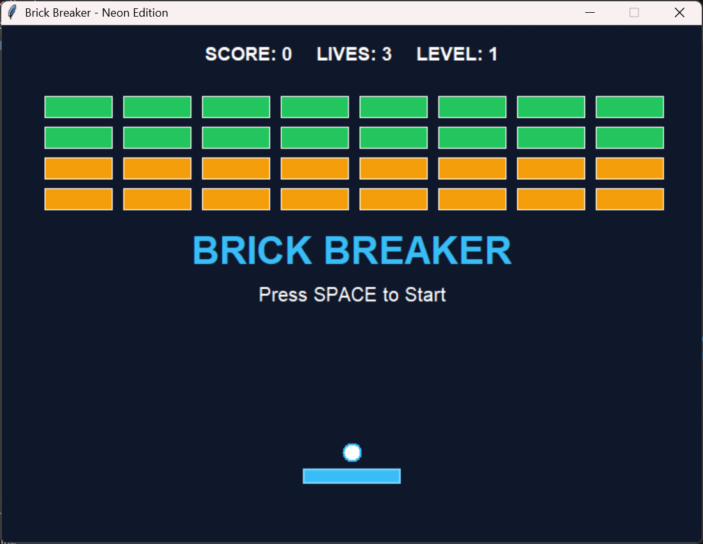

No.	Bagian kode	Perubahan
1	GameObject	Tetap dipakai sebagai parent class untuk objek game.
2	Ball	Menambahkan pengaturan kecepatan dan pantulan bola.
3	Paddle	Mengubah ukuran dan warna paddle serta memperbaiki batas pergerakan.
4	Brick	Menambahkan sistem ketahanan balok dan perubahan warna.
5	Game.__init__	Mengubah ukuran layar dan menambahkan variabel skor, level, nyawa, dan status permainan.
6	create_hud()	Menambahkan tampilan informasi permainan.
7	create_bricks()	Membuat jumlah baris dan ketahanan balok berdasarkan level.
8	check_collisions()	Memperbaiki deteksi tabrakan bola dengan paddle dan balok.
9	game_loop()	Mengatur jalannya permainan secara berulang.
10	toggle_game()	Menambahkan fitur Pause dan Resume.
11	check_game_status()	Mengatur kondisi kehilangan nyawa dan perpindahan level.
12	restart_game()	Menambahkan fitur mengulang permainan dari awal.